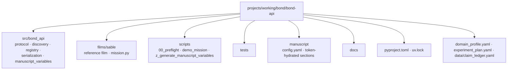

# BOND-API — Agent Operating Contract

**BOND-API** is the frozen mission protocol contract for the BOND film suite
(Layer 1, codename *THE PROTOCOL*). This is an active project in the BOND
suite at `projects/working/bond/bond-api/`.

## Scope and hard rules

1. **Work only inside this directory.** Never modify sibling bond packages,
   bond root files, or the template repo.
2. **Local-only working tree.** There is no remote; never push anywhere.
3. **The contract is frozen.** `src/bond_api/protocol.py` is the single
   contract every film package implements. Changes require a versioned
   migration — never a silent edit. Do NOT change it casually.
4. **Pure core / thin scripts.** All business logic lives in `src/bond_api/`
   (stdlib + `pyyaml` only — no `infrastructure.*` imports, no `numpy`).
   `scripts/` contains thin orchestrators only.
5. **No mocks.** Tests use real data, real files, real computation —
   no `unittest.mock`, no `MagicMock`, no `@patch`.
6. **Deterministic.** Fixed seeds; no untracked random reliance; `to_json`
   output is byte-deterministic (key-sorted, fixed indent).
7. **Quality gates.** `uv run pytest tests/ --cov=src --cov-fail-under=90`
   plus `uv run ruff check src/ scripts/ films/` and
   `uv run mypy src/ scripts/ films/` must all pass.
8. **Manuscript variables are injected.** `manuscript/*.md` tokens resolve
   through `src/bond_api/manuscript_variables.py::generate_variables()` from
   `manuscript/config.yaml` + the live protocol surface — never hand-author
   metrics in prose. `scripts/z_generate_manuscript_variables.py` is strict by
   default (unresolved tokens fail).

## Layer contract

| Surface | Rule |
| --- | --- |
| `src/bond_api/protocol.py` | Frozen dataclasses + `MissionProvider` Protocol — pure, stdlib only |
| `src/bond_api/registry.py` | `GadgetRegistry` + `MissionRegistry` — pure |
| `src/bond_api/discovery.py` | Slug-based discovery on `sys.path` — pure (importlib) |
| `src/bond_api/serialization.py` | Tagged JSON round-trips — pure |
| `src/bond_api/capabilities.py` | Soft brief validation, plan schema checks, provenance hashing, debrief normalization — pure (stdlib + `serialization`) |
| `src/bond_api/manuscript_variables.py` | Reads `manuscript/config.yaml` (pyyaml) |
| `films/<slug>/mission.py` | Film implementations of the contract (external) |
| `scripts/` | Thin orchestrators; may add paths and call `src/` only |
| `tests/` | Zero-mock; exercises `src/` and real films |

Dependency arrow: `scripts/` → `src/`; `tests/` → `src/` + `films/`.
Nothing imports upward.

## Directory structure



## Protocol for AI agents

Before modifying this project, read in order:

1. `docs/agent_instructions.md` — operational constraints (read-first).
2. `docs/architecture.md` — layer boundaries before touching `src/` or
   `scripts/`.
3. `docs/testing_philosophy.md` — zero-mock rules before writing tests.

## Verification checklist (before "done")

```bash
# 1. Tests + coverage gate (≥90% line + branch on src/)
uv run pytest tests/ --cov=src --cov-fail-under=90

# 2. No mocks in tests/
grep -r "unittest.mock\|MagicMock\|@patch\|create_autospec" tests/ || echo "Clean"

# 3. Pure core has no infrastructure imports
grep -nE "^(from|import) infrastructure" src/bond_api/*.py || echo "Clean"

# 4. No leftover exemplar scaffold strings (bracket split keeps this doc from matching itself)
rg -n "template[_]code_project" . || echo "Clean"

# 5. Code quality
uv run ruff check src/ scripts/ films/
uv run mypy src/ scripts/ films/

# 6. git status clean after commit(s)
git status
```

## See also

- [`README.md`](README.md) — human quickstart · [`TODO.md`](TODO.md) — backlog
  and integration points
- Live test count + measured coverage:
  [`docs/_generated/COUNTS.md`](../../../docs/_generated/COUNTS.md)
  (regenerated, never hardcoded here)
