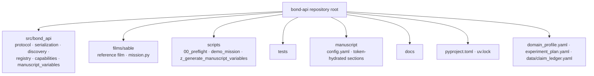

# BOND-API — Agent Operating Contract

**BOND-API** is the frozen mission protocol contract for the BOND film suite
(Layer 1, codename *THE PROTOCOL*). The package is published at
`github.com/docxology/bond-api`.

## Scope and hard rules

1. **Work only inside this directory.** Never modify sibling bond packages,
   bond root files, or the template repo.
2. **Published repository.** `origin` is `github.com/docxology/bond-api`;
   never force-push and never rewrite history.
3. **The contract is frozen.** `src/bond_api/protocol.py` is the single
   contract every film package implements. Changes require a versioned
   migration — never a silent edit. Do NOT change it casually.
4. **Pure core / thin scripts.** All business logic lives in `src/bond_api/`
   (stdlib + `pyyaml` only — no `infrastructure.*` imports, no `numpy`).
   `scripts/` contains thin orchestrators only.
5. **No mocks.** Tests use real data, real files, real computation —
   no `unittest.mock`, no `MagicMock`, no `@patch`.
6. **Deterministic.** Fixed seeds; no untracked random reliance; `to_json`
   output is byte-deterministic (key-sorted, fixed indent). No wall clock in
   generated artifacts: `generate_variables()` reads no clock, so regenerating
   `output/` twice on one interpreter writes identical bytes
   (`tests/test_regeneration_determinism.py`). `PYTHON_VERSION` is the one
   environment-derived token — a different interpreter changes those bytes by
   design.
7. **Quality gates.** `uv run --extra dev pytest tests/ --cov=src --cov-fail-under=90`
   plus `uv run --extra dev ruff check src/ scripts/ films/` and
   `uv run --extra dev mypy src/ scripts/ films/` must all pass.
8. **A gate must be able to fail.** Any check added here needs an input that
   makes it fail, supplied in a test: inventory scans assert a non-empty scan
   set, always-satisfied validity checks are extracted into callables that a
   test can feed invalid input, and structural claims about code are made with
   `ast`, not substring greps. See `docs/testing_philosophy.md`.
9. **Manuscript variables are injected.** `manuscript/*.md` tokens resolve
   through `src/bond_api/manuscript_variables.py::generate_variables()` from
   `manuscript/config.yaml` + the live protocol surface — never hand-author
   metrics in prose. `scripts/z_generate_manuscript_variables.py` is strict by
   default (unresolved tokens fail).

## Layer contract

| Surface | Rule |
| --- | --- |
| `src/bond_api/protocol.py` | Frozen dataclasses + `MissionProvider` Protocol — pure, stdlib only |
| `src/bond_api/registry.py` | `GadgetRegistry` + `MissionRegistry` — pure |
| `src/bond_api/discovery.py` | Slug-based discovery on `sys.path` — pure (importlib) |
| `src/bond_api/serialization.py` | Tagged JSON round-trips — pure |
| `src/bond_api/capabilities.py` | Soft brief validation, plan schema checks, provenance hashing, debrief normalization — pure (stdlib + `serialization`) |
| `src/bond_api/manuscript_variables.py` | Reads `manuscript/config.yaml` (pyyaml) + the `fail_under` gate in `pyproject.toml`; owns `require_surface` and strict tree resolution |
| `films/<slug>/mission.py` | Film implementations of the contract (external) |
| `scripts/` | Thin orchestrators; may add paths and call `src/` only |
| `tests/` | Zero-mock; exercises `src/` and real films |

Dependency arrow: `scripts/` → `src/`; `tests/` → `src/` + `films/`.
Nothing imports upward.

## Directory structure



## Protocol for AI agents

Before modifying this project, read in order:

1. `docs/agent_instructions.md` — operational constraints (read-first).
2. `docs/architecture.md` — layer boundaries before touching `src/` or
   `scripts/`.
3. `docs/testing_philosophy.md` — zero-mock rules before writing tests.

## Build / test / verify

```bash
# Install (dev extras: pytest, pytest-cov, ruff, mypy, types-PyYAML)
uv sync --extra dev

# Run one test
uv run --extra dev pytest tests/test_capabilities.py::test_fingerprint_is_deterministic -v

# Run the package end-to-end without the test suite
uv run python scripts/00_preflight.py
uv run python scripts/demo_mission.py
uv run python scripts/z_generate_manuscript_variables.py
```

There is no build step and no rendering step inside this package: the PDF is
produced by the monorepo `infrastructure.rendering` pipeline from the resolved
sections this package writes to `output/manuscript/`.

## Verification checklist (before "done")

```bash
# 1. Tests + coverage gate (line + branch on src/; floor from pyproject fail_under)
uv run --extra dev pytest tests/ --cov=src --cov-fail-under=90

# 2. No mocks in tests/
grep -r "unittest.mock\|MagicMock\|@patch\|create_autospec" tests/ || echo "Clean"

# 3. Pure core has no infrastructure imports
grep -nE "^(from|import) infrastructure" src/bond_api/*.py || echo "Clean"

# 4. No leftover exemplar scaffold strings (bracket split keeps this doc from matching itself)
rg -n "template[_]code_project" . || echo "Clean"

# 5. Code quality (lint, format, types)
uv run --extra dev ruff check src/ scripts/ films/ tests/
uv run --extra dev ruff format --check src/ scripts/ films/ tests/
uv run --extra dev mypy src/ scripts/ films/

# 6. Manuscript tokens hydrate strictly (an unresolved token exits non-zero)
uv run python scripts/z_generate_manuscript_variables.py

# 7. git status clean after commit(s)
git status
```

Steps 1, 5, and 6 are the gates that can actually fail on a bad change; run
all three before claiming a change is done, and read the output rather than
the exit code alone.

## See also

- [`README.md`](README.md) — human quickstart, module map, and the
  `MissionProvider` surface · [`TODO.md`](TODO.md) — backlog and integration
  points · [`STANDALONE.md`](STANDALONE.md) — publication/lift guide
- [`docs/`](docs/) — `agent_instructions.md` (seven rules + token map),
  `architecture.md` (module-by-module), `testing_philosophy.md` (zero-mock and
  non-vacuous gates)
- Test counts and measured coverage are never written into these documents.
  They come from the run: `uv run --extra dev pytest tests/ --cov=src`.
