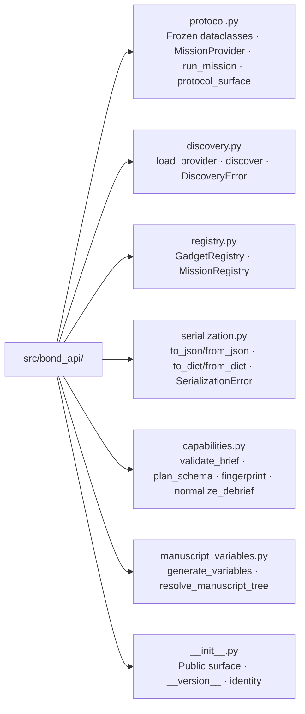

# src/ — BOND-API Package

## Overview

`src/bond_api/` is the BOND-API package — the frozen mission protocol
contract for the BOND film suite (Layer 1, codename *THE PROTOCOL*). All
business logic lives here; `scripts/` stays thin.

## Key Concepts

- **Pure core**: `protocol.py` is stdlib-only and dependency-free — liftable
  into any Python environment. `registry.py`, `discovery.py`, and
  `serialization.py` are pure services over the protocol surface.
- **Frozen surface**: the dataclasses and `MissionProvider` Protocol in
  `protocol.py` are the contract every film implements. Changes are versioned
  migrations, never silent edits.
- **Zero-mock testability**: every module is exercised with real data and
  real computation (`tests/`).
- **Determinism**: `to_json` is byte-deterministic; no hidden state.

## Directory Structure



## Rules

- No `infrastructure.*` imports anywhere in `src/bond_api/`.
- No `numpy`; the only third-party dependency is `pyyaml` in
  `manuscript_variables.py` (config parsing).
- Type hints + docstrings on every public function (mypy-clean).
- Public surface is exported from `__init__.py` — keep `__all__` in sync.

## Usage Examples

```python
from bond_api.discovery import discover
from bond_api.registry import MissionRegistry
from bond_api.protocol import ReconRequest, run_mission

providers = discover(search_paths=["films"])  # {slug: provider}
registry = MissionRegistry()
registry.register_all(providers)
debrief = run_mission(registry.lookup("sable"), ReconRequest(goal="survey"))
```

```python
from bond_api.protocol import MissionBrief
from bond_api.serialization import to_json, from_json

wire = to_json(brief)  # deterministic JSON, no pickling
round_tripped = from_json(wire, expected=MissionBrief)
```

## API Reference (public)

### protocol.py

- Frozen dataclasses: `MissionBrief`, `ReconRequest`, `ReconReport`,
  `MissionPlan`, `MissionOutcome`, `Debrief`, `Provenance`, `Asset`,
  `Constraint`, `Finding`, `Step` — each validated in `__post_init__`.
- `MissionProvider` — runtime-checkable structural Protocol (`film` + the five
  stages `brief`/`recon`/`plan`/`execute`/`debrief`).
- `run_mission(provider, request) -> Debrief` — the deterministic five-stage
  flow.
- `protocol_surface() -> dict[str, str | tuple[str, ...]]` — canonical
  inventory (identity, codename, dataclass names, provider flow).

### discovery.py

- `load_provider(slug, *, search_paths=None) -> MissionProvider` — strict
  single-film load with binding and identity checks.
- `discover(*, slugs=None, search_paths=None) -> dict[str, MissionProvider]` —
  autodetect candidates (dirs with `mission.py`) or take an explicit slug
  list; skips un-discoverable slugs.
- `DiscoveryError(RuntimeError)` — every failure mode.

### registry.py

- `GadgetRegistry` — `register(film, gadgets)`, `lookup(film, gadget)`,
  `drop(film, gadget)`, `drop_film(film)`, `films()`, `gadgets_for(film)`,
  `contains`, `__contains__`, `__len__`.
- `MissionRegistry` — `register(provider)`, `register_all(providers)`,
  `lookup(slug)`, `drop(slug)`, `slugs()`, `providers()`, `__iter__`,
  `__contains__`, `__len__`.

### serialization.py

- `to_json(obj) -> str` / `from_json(text, *, expected=None) -> Any` —
  tagged JSON round-trips (reserved key `__bond_type__`).
- `to_dict(obj)` / `from_dict(data)` — dict form of the same contract.
- `SerializationError(ValueError)`.

### capabilities.py

- `brief_issues(brief) -> tuple[str, ...]` — advisory brief issues (duplicate
  asset names, duplicate constraint kinds, duplicate objectives, whitespace-
  slack asset names).
- `validate_brief(brief) -> BriefReport` — frozen report with `ok` and
  `issues`; `BriefReport` is exported.
- `plan_schema_issues(plan, expected_steps=None) -> tuple[str, ...]` /
  `require_plan_schema(plan, expected_steps=None) -> None` — duplicate step
  names, malformed param keys, non-serializable params, and optional exact
  expected step-name sequence (raises `ValueError`).
- `fingerprint(*parts) -> str` — deterministic SHA-256 over canonical JSON.
- `hash_provenance(provenance) -> str` — fingerprint of all four fields.
- `derive_provenance(*, package_version, seed, inputs=(), wall_time_s=0.0) ->
  Provenance` — provenance with `input_hash` derived from `inputs`.
- `normalize_lessons(lessons) -> tuple[str, ...]` /
  `normalize_debrief(debrief) -> Debrief` — strip/drop/dedupe lessons
  (first-occurrence order), re-validate outcome.

### manuscript_variables.py

- `load_manuscript_config(config_path=None) -> dict` — validates
  `manuscript/config.yaml`.
- `generate_variables(*, config_path=None, require_outputs=True) -> dict[str, str]` —
  the `{{TOKEN}}` map (config + protocol surface).
- `resolve_manuscript_tree(variables, *, manuscript_dir=None, output_dir=None, strict=True)` —
  token-substitutes `NN_*.md` sections into `output/manuscript/`.

## Testing

```bash
uv run pytest ../tests/ --cov=src --cov-fail-under=90 -v
```
