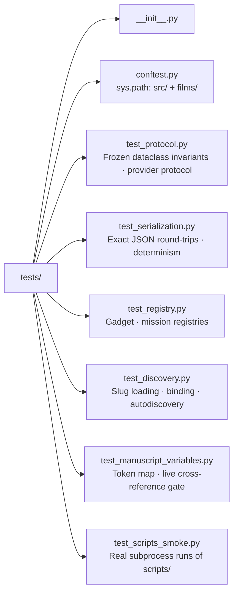

# tests/ — Zero-Mock Test Suite

## Overview

Tests for the BOND-API protocol package. Every test uses real data, real
files, real film packages, and real computation — no `unittest.mock`,
`MagicMock`, `@patch`, or `create_autospec`.

## Directory Structure



## Conventions

- **No mocks.** Scripted providers are real classes implementing the five
  stages; discovery tests write real `mission.py` modules to `tmp_path` and
  import them through `sys.path`.
- **Deterministic.** Fixed seeds/inputs; serialization asserts byte equality;
  subprocess smoke asserts stable output lines only.
- **Coverage.** The gate is ≥90% line + branch on `src/`:
  `uv run pytest tests/ --cov=src --cov-fail-under=90 --cov-report=term-missing`.
- **Isolation.** Discovery tests use unique slugs per package so
  `sys.modules` caching stays deterministic.

## Running

```bash
uv run pytest tests/ -v
uv run pytest tests/ --cov=src --cov-fail-under=90
uv run pytest tests/test_discovery.py -k "autodiscovery" -v
```

See [`../docs/testing_philosophy.md`](../docs/testing_philosophy.md) for the
full testing doctrine.
